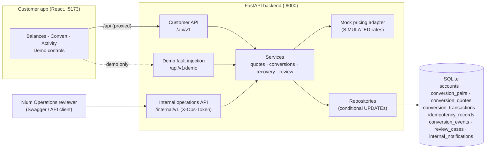

# Nium Stablecoin Conversion Prototype

**AI-assisted prototype demonstrating a business wallet conversion workflow, transaction safety and operational exception handling.**

Built for the **Nium Staff Product Manager – Digital Assets** assignment.

**Repository:** https://github.com/vigneshpalani380/nium-stablecoin-conversion-prototype · **Submission tag:** [`v1.0-submission`](https://github.com/vigneshpalani380/nium-stablecoin-conversion-prototype/tree/v1.0-submission)

```sh
git clone https://github.com/vigneshpalani380/nium-stablecoin-conversion-prototype.git
```

The prototype shows how a business customer, such as a marketplace treasury team, can convert between fiat and stablecoin balances while keeping balances accurate, processing transactions safely, and showing a clear status at every step. That includes the cases where something goes wrong.

> **Synthetic-data prototype.** It does not move real funds, and it does not connect to any live blockchain, custody, banking, trading or email service. All exchange rates are deterministic and labelled *Simulated*.

---

## Contents

1. [What it demonstrates](#1-what-it-demonstrates)
2. [Product capabilities](#2-product-capabilities)
3. [Architecture](#3-architecture)
4. [Transaction lifecycle](#4-transaction-lifecycle)
5. [Demonstration scenarios](#5-demonstration-scenarios)
6. [Setup and running](#6-setup-and-running)
7. [Testing and verification](#7-testing-and-verification)
8. [AI correction record](#8-ai-correction-record)
9. [Scope and limitations](#9-scope-and-limitations)
10. [Repository map](#10-repository-map)

---

## 1. What it demonstrates

| Scenario | What happens | What the customer sees |
|---|---|---|
| **Normal** | Funds are reserved, then settled atomically | *Completed*, with before/after balances |
| **Exception** | A definitive failure before commit; the reservation is released exactly once | *Conversion failed — funds released* |
| **Ambiguous** | Confirmation is lost during the database commit. Automated recovery cannot establish the outcome, so automation stops, funds stay reserved, and Nium Operations receives an internal (simulated) notification | *Under review* |

The central product idea is a **clear boundary between automation and human intervention**. The system never assumes success or failure without authoritative evidence, and the internal review workflow is kept entirely out of the customer experience.

---

## 2. Product capabilities

### Implemented

| Capability | Details |
|---|---|
| **Fiat and stablecoin accounts** | Five accounts per customer: **USD**, **INR** (fiat), **USDC-Solana**, **USDC-Base**, **USDT-Solana**. Each asset + network pair is a separate account, so USDC-Solana and USDC-Base are distinct. |
| **Three balance types** | **Available** (spendable), **Reserved** (held for an outgoing conversion in progress), **Pending** (incoming, not yet spendable). Stored as integer minor units; `Decimal` in code; never floating point. |
| **Configured conversion pairs** | Defined in [`backend/config/settings.py`](backend/config/settings.py) and loaded into the `conversion_pairs` table on startup. **USDC-Solana → USD**, **USD → USDC-Solana**, **USDC-Solana → INR**, **INR → USDC-Solana**. USDC-Base and USDT-Solana are visible but have no enabled pairs. |
| **Quote and confirmation** | Quotes are valid for 30 seconds. The UI shows gross amount, fee, net amount, rate and the amount received, with a countdown. Confirmation reads values from the stored quote, never from the browser. |
| **Fee** | 0.5% of the gross source amount, in the source currency. `net = gross − fee`; `received = net × rate`, rounded half-up to the destination precision. |
| **Atomic balance reservation** | One conditional SQL `UPDATE … WHERE available_minor >= :amount` checks and reserves in the same step, so two concurrent requests can never both spend the same balance. |
| **Settlement** | One database transaction debits the reservation, credits the destination, writes the completed conversion record and finalises the idempotency record. |
| **Transaction history** | The Activity tab shows date, amounts, fee, status and ID. The detail view shows rate, quote ID, idempotency key and before/after balances for both accounts. |
| **Idempotency** | `Idempotency-Key` is required to confirm and is unique per customer in the database. Same key and same request returns the original result; same key with a different request returns `409`. The browser uses one key per quote and blocks double-clicks. |
| **Timeout and uncertain-outcome recovery** | A lost response is never treated as failure: the client looks up the result by its original key. A lost commit triggers automated recovery against the authoritative records. |
| **Customer statuses** | *Completed*, *Processing*, *Failed — funds released*, *Under review*. Status is always shown in text, not colour alone. |
| **Internal human-review notification** | When recovery cannot establish the outcome, the system opens one review case and one notification addressed to OPERATIONS by EMAIL (simulated), with full evidence. These are exposed only through an internal API (`/internal/v1`) protected by a demo token. The reviewer's decision is validated against the records. |
| **Audit trail** | Every state transition is recorded internally (`conversion_events`), along with review cases and notifications, and kept after resolution. |

### Simulated (by design)

| Simulated | How |
|---|---|
| Exchange rates | Fixed rates in config, labelled `SIMULATED` (for example 1 USDC-Solana = 83.25 INR) |
| Failures and outages | Demo fault injection: *Demo controls* panel and `/api/v1/demo/faults` |
| Email to Nium Operations | Stored in `internal_notifications` with status `QUEUED` and written to the backend log; no email is sent |
| Customer identity | One seeded demo customer, `cust-demo-marketplace`; no login |

---

## 3. Architecture

| Layer | Technology |
|---|---|
| Frontend | React 18, TypeScript, Vite 6; Vitest + Testing Library |
| Backend | Python 3.12, FastAPI, Pydantic v2, SQLAlchemy 2 |
| Database | SQLite (WAL mode). Every transaction uses `BEGIN IMMEDIATE`, so concurrent writes are serialised. |
| API | JSON over HTTP under `/api/v1`. During development the Vite server forwards `/api` to the backend. Interactive docs are at `/docs`. |



**Backend modules** (in [`backend/`](backend/)):

- `api/`: HTTP routers only, with no business logic.
- `services/`: domain rules.
  - `quotes`: pricing math, validation.
  - `conversions`: reserve, settle, release, recovery, escalation.
  - `idempotency`: key and replay rules.
  - `operations`: settlement evidence, notification builder, review.
  - `transactions`: read side.
- `repositories/`: persistence. Every balance change is a single guarded `UPDATE`.
- `adapters/pricing/`: the mock pricing adapter. A live rate source would replace only this module.
- `config/`, `seed/`, `models/`, `db/`, `domain/`: config, seed data, models, database setup, and money/error types.

**How balances are kept accurate:**
- The `accounts` table holds the current available, reserved and pending balances.
- Each conversion is a single `conversion_transactions` row holding both sides, the fee, the rate, and before/after snapshots of all three balances for both accounts.
- The frontend has no way to write balances. There is deliberately no balance-mutation endpoint.

---

## 4. Transaction lifecycle

### Normal path

```
Request → Validate → Quote (30 s) → Confirm (Idempotency-Key) → Reserve → Settle → Completed
```

| Step | Source account (gross G) | Destination account (amount D) | Status |
|---|---|---|---|
| Reserve | available −G, reserved +G | pending +D | `RESERVED` |
| Settle | reserved −G | pending −D, available +D | `COMPLETED` |
| Release (on failure) | reserved −G, available +G | pending −D | `FAILED` |

Each step is one atomic database transaction.

### Why these safeguards exist

- **Why reserve first?** Reserving sets the funds aside before any value moves. A balance can't be spent twice while a conversion is in flight, and the customer can see that the funds are committed.
- **Why is check-and-reserve atomic?** If the balance check and the update were separate steps, two simultaneous requests (for example a double-click) could both pass the check against the same balance. Here the guard is in the `WHERE` clause of the update itself. If no row is updated, the request gets `INSUFFICIENT_BALANCE` and nothing changes.
- **How idempotency prevents duplicates.** The client sends one key per quote. The database enforces one record per customer and key. Repeating the request replays the original result, and a quote can be consumed only once. Tests fire 10 concurrent confirms with the same key; exactly one conversion is created.
- **Why a timeout is not a failure.** If a response is lost, the conversion may still have completed. The client keeps its original key and asks `GET /api/v1/conversion/transactions/by-idempotency-key/{key}`. It never resubmits with a new key.

### Exception (definitive failure)

A known failure raised *before* commit means nothing was committed. The reservation is released exactly once, the conversion is `FAILED`, and no review is created.

### Ambiguous outcome (uncertain commit)

```
Reserve → SETTLEMENT_ATTEMPTED → connection lost during COMMIT → OUTCOME_UNCERTAIN → automated recovery
```

Automated recovery reads the authoritative records, using the original conversion ID and idempotency key, up to 3 times:

| Evidence found | Action |
|---|---|
| Settlement marker, debit and credit all present → **committed** | Confirm `COMPLETED` (no money moves) |
| No marker, reservation and pending credit still held → **not committed** | Release the reservation exactly once, `FAILED` |
| Lookups keep failing, or records are inconsistent | **Automation stops** → `REVIEW_REQUIRED` |

When automation stops, the system:
- does **not** retry settlement, create a new key or a new conversion, release the reservation, or credit the destination;
- opens **one** review case and **one** simulated email to **Nium Operations** containing:
  - the case and conversion IDs and the idempotency key,
  - the amounts, rate and fee,
  - the financial position,
  - the error evidence and every recovery attempt,
  - a plain-language explanation and the required reviewer actions;
- shows the customer **Under review**, with funds reserved and the destination credit marked *not yet confirmed*.

A reviewer resolves the case through the internal API with `CONFIRM_COMMITTED`, `CONFIRM_NOT_COMMITTED` or `ESCALATE`. The backend **refuses any decision that contradicts the records**.

Full procedure: [docs/operations_review_procedure.md](docs/operations_review_procedure.md).

---

## 5. Demonstration scenarios

Start the app (see [§6](#6-setup-and-running)) and open http://localhost:5173.

- **Seed balances:** USD 25,000.00 · INR 2,000,000.00 · USDC-Solana 5,000.00 · USDC-Base 1,000.00 · USDT-Solana 1,000.00.
- **Demo controls:** a collapsible *Demo controls (simulated failures)* panel at the bottom of the **Convert** tab. Click **Reset demo data** in that panel before each scenario.

### Scenario 1 — Normal conversion

1. Open **Convert**. Set **From** to `USD`, **To** to `USDC-Solana` and **Amount to convert** to `10000.00`, then click **Get quote**.
2. Review the quote:
   - gross 10,000.00 USD,
   - fee (0.5%) − 50.00 USD,
   - net 9,950.00 USD,
   - rate `1 USD = 1.0000 USDC` with the label **Simulated demo rate**,
   - you receive 9,950.00 USDC,
   - 30-second countdown.
3. Click **Confirm conversion**. Double-clicking still creates one conversion.
4. **Expected:** *Conversion completed*, with a reference and before/after tables. USD 25,000.00 → **15,000.00**; USDC-Solana 5,000.00 → **14,950.00**. **Activity** shows one completed row.

### Scenario 2 — Exception (definitive failure)

1. In **Demo controls**, tick **Fail during settlement (reservation is released)**. This applies to the next conversion only.
2. Convert USD 10,000.00 → USDC-Solana as in Scenario 1.
3. **Expected:** *Conversion failed — funds released*. Balances are unchanged: the reservation was released exactly once. **Activity** shows the row as **Failed — funds released** with `SETTLEMENT_FAILED`. No internal notification is created.

### Scenario 3 — Ambiguous outcome → human review

1. In **Demo controls**, set **Simulated uncertain database commit (next conversion)** to **Scenario C — recovery cannot confirm → Under review + ops email**.
2. Convert USD 10,000.00 → USDC-Solana.
3. **What happens behind the scenes (simulated):**
   - the settlement commit loses its database connection;
   - all 3 automated recovery lookups fail;
   - automation stops and opens a review case and notification.
4. **What the customer sees:** **Status: Under review**, with the message:

   > We couldn't confirm the final settlement status of your conversion. Your funds remain reserved while our operations team investigates. You do not need to submit the conversion again. We'll notify you when the status is resolved.

   It also shows the conversion ID, amounts, *Source reserved*, *Destination credit — not yet confirmed* and *Last updated*. No resubmit button is offered. On the **Balances** tab, USD shows *Reserved 10,000.00* and USDC-Solana shows *Pending 9,950.00*.
5. **Inspect the internal notification (Nium Operations side, not the customer app):**
   - Open **http://localhost:8000/docs** and use the **internal-operations (not customer-facing)** endpoints.
   - Every call needs the header `X-Ops-Token: demo-ops-token`. Without it the API returns `401`.

   | Endpoint | Shows |
   |---|---|
   | `GET /internal/v1/notifications` | `notification_id`, `event: CONVERSION_REVIEW_REQUIRED`, `channel: EMAIL`, `recipient_group: OPERATIONS`, `status: QUEUED`, `simulated: true` |
   | `GET /internal/v1/notifications/{notification_id}` | Full simulated email. Subject *Action Required – Conversion Outcome Unresolved*, priority HIGH, sections **A** Case, **B** Transaction, **C** Financial position, **D** Evidence (database error, record/debit/credit found, idempotency lookup, 3 timestamped recovery attempts, why automation stopped), **E** Plain-language explanation, **F** Required reviewer actions |
   | `GET /internal/v1/review-cases/{case_id}` | Case, evidence, notification and full audit trail |
   | `GET /internal/v1/review-cases/{case_id}/inspection` | Read-only check of the authoritative records → `NOT_COMMITTED`, supported action `CONFIRM_NOT_COMMITTED` |
   | `POST /internal/v1/review-cases/{case_id}/resolution` | Body `{"action":"CONFIRM_NOT_COMMITTED","reviewer":"ops.demo","note":"No settlement marker; reservation intact"}` releases the reservation once. `CONFIRM_COMMITTED` is refused with `409 RESOLUTION_NOT_SUPPORTED_BY_EVIDENCE`. |

6. Back in the customer app, click **Refresh status**. The conversion now shows as failed with funds released, and balances return to their starting values.

A captured example email is in [docs/evidence/sample_ops_notification.txt](docs/evidence/sample_ops_notification.txt).

**Automation without a human:** the same dropdown also offers *Settled, ack lost — automated recovery confirms Completed* and *Rolled back, ack lost — automated recovery releases funds*. Neither creates a review case. A longer demo script, including reserved/pending visibility, expired quotes and lost responses, is in [docs/demo_runbook.md](docs/demo_runbook.md).

---

## 6. Setup and running

### Prerequisites

- **Python 3.12** (tested with 3.12.10)
- **Node.js 20+** and npm (tested with Node 24.19, npm 11.17)
- **Git**

No database server is needed. SQLite is created and seeded automatically.

### Install

From the repository root:

```sh
# Backend
python -m venv .venv
# Windows (Git Bash / PowerShell):  .venv/Scripts/python -m pip install -r requirements-dev.txt
# macOS / Linux:                    .venv/bin/python -m pip install -r requirements-dev.txt

# Frontend
cd frontend
npm install
cd ..
```

### Environment configuration (optional)

No configuration is required; the defaults work out of the box. [`.env.example`](.env.example) lists the optional settings, which are read from **shell environment variables** (no `.env` file is loaded automatically):

| Variable | Default | Purpose |
|---|---|---|
| `WALLET_DATABASE_URL` | `sqlite:///./wallet.db` | Database location |
| `WALLET_DEMO_MODE` | `true` | Enables the demo fault-injection endpoints and panel |
| `WALLET_QUOTE_TTL_SECONDS` | `30` | Quote validity in seconds |
| `WALLET_OPS_TOKEN` | `demo-ops-token` | Demo credential for the internal operations API |

### Database

There are no migrations to run. On first start, the backend creates `wallet.db` in the directory it was started from, seeds the demo accounts, and loads the configured pairs. To return to seed balances, use **Reset demo data** in the UI or `POST /api/v1/demo/reset`.

### Start

Use two terminals, both starting from the repository root:

```sh
# Terminal 1 — backend on http://localhost:8000
# Windows:      .venv/Scripts/python -m uvicorn backend.main:create_app --factory --port 8000
# macOS/Linux:  .venv/bin/python -m uvicorn backend.main:create_app --factory --port 8000
```

```sh
# Terminal 2 — frontend on http://localhost:5173
cd frontend
npm run dev
```

| URL | What |
|---|---|
| http://localhost:5173 | Customer wallet app |
| http://localhost:8000/docs | Swagger / OpenAPI: customer, demo and internal-operations endpoints |
| http://localhost:8000/health | Health check |

---

## 7. Testing and verification

### Commands

```sh
# Backend: unit, API, concurrency and live-server E2E (Windows path shown; use .venv/bin on macOS/Linux)
.venv/Scripts/python -m pytest

# Regenerate the E2E evidence files in docs/evidence/
E2E_EVIDENCE_DIR=docs/evidence .venv/Scripts/python -m pytest tests/e2e

# Frontend
cd frontend
npm test            # Vitest + Testing Library
npm run build       # TypeScript type-check + production build
npx eslint .
```

### Test suites

| Suite | Location | What it covers | Tests |
|---|---|---|---|
| Backend unit | `tests/quotes`, `tests/models`, `tests/config` | Fee/rounding math, `Decimal` parsing, minor-unit conversion, schema constraints (non-negative balances, unique keys), seed and config-driven pairs | 46 |
| Backend API / integration | `tests/api`, `tests/transactions`, `tests/test_health.py` | Read APIs, no balance-write endpoint, error envelope, history and detail | 8 |
| Financial safety | `tests/conversions`, `tests/idempotency` | Atomic reserve/settle/release, rollback on injected failure, expired quotes, balance recheck, idempotent replay and conflict, lost-response recovery, **concurrent double-click races** (same key ×10, different keys, two quotes over the balance), randomised invariant sequence | 26 |
| Ambiguous outcome and review | `tests/review` | Recovery of committed and rolled-back commits, human review, customer API exposes nothing internal, notification contents, no duplicate notifications, no balance change on escalation, reviewer decisions checked against records | 16 |
| E2E (live server over HTTP) | `tests/e2e` | Starts a real uvicorn process. Normal, expired, lost response, double-click, settlement failure, reserved/pending visibility, Scenario C including the notification and resolution | 7 |
| Frontend | `frontend/src/**/*.test.ts(x)` | Amount validation, formatting, confirm state machine (double-click guard, same-key recovery, not-received, unresolved), Convert page flows, Under review view, shell and Activity | 38 |

### Latest results

Run on 2026-11-19, Windows 10, Python 3.12.10, Node 24.19:

- **Backend:** `103 passed` (all of the suites above, including the 7 live-server E2E tests)
- **Frontend:** `38 passed` (6 files); `tsc` type-check, ESLint and production build all pass

### Evidence

- [docs/evidence/e2e_scenarios.md](docs/evidence/e2e_scenarios.md): captured request/response and balance evidence for each scenario (JSON version alongside)
- [docs/evidence/sample_ops_notification.txt](docs/evidence/sample_ops_notification.txt): a generated internal notification (JSON version alongside)

---

## 8. AI correction record

[docs/correction_record.md](docs/correction_record.md) records a genuine weakness in the AI-generated build plan: it checked the available balance and then reserved it in a *separate* database update. That would have allowed two simultaneous conversions to reserve the same funds.

The record covers the human correction (the check and the reservation must be one atomic operation), the implementation change (a conditional `UPDATE … WHERE available_minor >= :amount`), and the verification (concurrent-confirmation tests and the live-server double-click E2E scenario).

---

## 9. Scope and limitations

**Not production financial infrastructure.** Specifically:

- **Synthetic data only.** One seeded demo customer, with no real customer data.
- **No live funds**, and no BitGo, blockchain, custody, banking, liquidity-provider or market-data integration. Rates are fixed and simulated.
- **No real email.** Internal review notifications are simulated: stored and logged with status `QUEUED`. Customers are not actively notified when a case is resolved; they see the new status on refresh.
- **Simulated outages.** Commit loss and recovery-lookup failures are injected deterministically, with no real database outage. In the human-review scenario, the escalation is written to the same SQLite database; production would use a separate durable outbox or alerting path.
- **No authentication.** The internal operations API uses a static demo token (`demo-ops-token`), with no real identity, permissions or four-eyes approval.
- **Simplified ledger.** `conversion_transactions` is the single audit record; there is no double-entry general ledger and no fee-revenue account.
- **SQLite.** Writes are serialised with `BEGIN IMMEDIATE`, which is correct but low throughput. There are no schema migrations; delete `wallet.db` after model changes.
- **Recovery timing.** Automated recovery runs inside the request as 3 immediate attempts. Production would add backoff and a background reconciler that rechecks open cases.
- **No browser-automation E2E.** The UI is covered by component tests with a fake API, and the API end-to-end against a live server.

More detail: [docs/known_limitations.md](docs/known_limitations.md).

---

## 10. Repository map

| Path | Contents |
|---|---|
| [`backend/`](backend/) | FastAPI application (entry point `backend.main:create_app`) |
| [`frontend/`](frontend/) | React + Vite customer app (entry point `src/main.tsx`) |
| [`tests/`](tests/) | Backend pytest suites, including live-server E2E |
| [`docs/`](docs/) | Demo runbook, operations review procedure, known limitations, AI correction record, test evidence |
| [`nium_conversion_prototype_docs/`](nium_conversion_prototype_docs/) | Product and technical specification pack (PRD, scope, backend, data model, API, UX, brand, testing) and the task breakdown used to build the prototype |
| [`AGENTS.md`](AGENTS.md), [`CLAUDE.md`](CLAUDE.md) | Instructions given to the AI coding assistant |
| [`.env.example`](.env.example) | Optional configuration (defaults only) |
